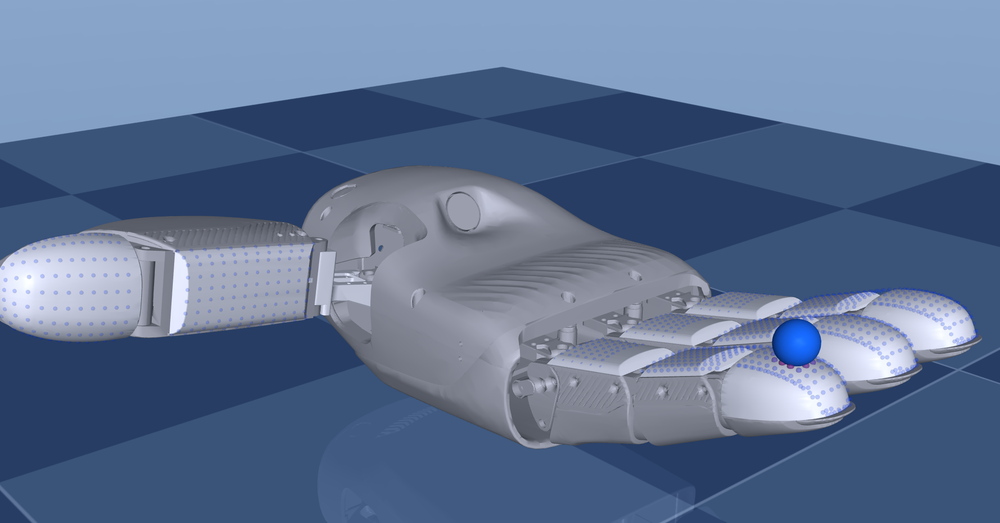
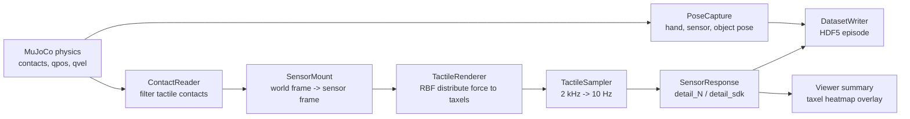

# DexH13Sim

DexH13Sim 是一个面向 DexH13 多维触觉灵巧手的 MuJoCo 仿真与数据采集工程。项目目标不是只打开一个手模型，而是逐步实现可交互、可采集、可验证、可向真实 DexH13 SDK 对齐的仿真平台。

当前版本已经实现了 V1 主链路：DexH13 手模型、11 个触觉传感器、1140 个 taxel、三轴触觉张量生成、10 Hz SDK 风格数据输出、手指/物体交互、taxel 热力图显示、HDF5 episode 采集和测试验证。V1.1 已加入实机标定桥接工具，可以用真实按压样本拟合 RBF 扩散参数、模板级三轴响应矩阵和基础偏置。

需要明确的是：当前触觉数据是基于 MuJoCo 刚体接触力和 RBF 空间分配得到的工程近似，不是厂家级真实触觉传感器内部算法或实机标定结果的完整复刻。项目已经具备采集管线和接口形状，但要达到高可信 sim-to-real，还需要官方动力学、电机、触觉标定和实机对齐数据。



## 项目状态

| 模块 | 当前状态 |
| --- | --- |
| MuJoCo 手模型 | 已生成正式 `hand.xml`，包含 16 个可控 joint、11 个 tactile geom、11 个 sensor frame site |
| 原始资产整理 | 已将 ROS/URDF/MJCF/mesh 原始文件归档到 `assets/dexh13_raw/` |
| 触觉 taxel | 已生成 5 类模板 CSV，共 1140 个 taxel |
| 触觉生成 | 已实现 contact 读取、sensor frame 变换、RBF 力分配、SDK 风格输出 |
| 采样频率 | MuJoCo 物理 2 kHz，正式触觉帧 10 Hz，metadata 记录官方名义 80 Hz |
| 姿态采集 | 已记录手关节、sensor frame、物体位姿、物体速度和 contact count |
| 交互查看 | 已支持 MuJoCo viewer、键盘控制、物体控制、taxel 热力图 overlay |
| 数据保存 | 已支持 HDF5 episode 写入、检查、绘图和回放 |
| 自动测试 | 已有 pytest 覆盖核心链路 |
| 实机触觉标定 | 已实现样本转换、分阶段 z/x/y 轴拟合、RBF 扩散拟合、模板级 `A_matrix/bias_N` 拟合和评估；仍需要真实样本 |
| 高保真数字孪生 | 未完成，需要厂家动力学参数、更多触觉标定项和真实 episode 对齐 |

## 目录结构

```text
dexh13-tactile-sim/
├── assets/
│   ├── dexh13_raw/
│   │   └── dexh13_hand_right_description/   # 原始 ROS/URDF/MJCF/mesh 资产
│   └── dexh13_mjcf/
│       ├── hand.xml                         # 正式 DexH13 MuJoCo 手模型
│       ├── free_object_scene.xml            # 默认交互物体场景
│       ├── interactive_press_scene.xml      # 弹性压入测试场景
│       └── test_press_scene.xml             # 烟雾测试场景
├── configs/
│   ├── sensors.yaml                         # 11 个触觉传感器实例、SDK 顺序、挂载关系
│   ├── calibration.yaml                     # 采样率、RBF、noise、clip、lsb_per_N 等配置
│   ├── sim.yaml                             # 仿真配置
│   └── taxel_templates/                     # 5 类 taxel 模板 CSV
├── dexh13sim/
│   ├── sensor_table.py                      # SDK 顺序和 1140 taxel 切片
│   ├── taxel_template.py                    # taxel CSV 加载、normal 处理
│   ├── sensor_mount.py                      # MuJoCo sensor pose 和 geom->sensor 映射
│   ├── contact_reader.py                    # tactile contact 过滤和力坐标变换
│   ├── tactile_renderer.py                  # RBF 接触力到 taxel 的渲染
│   ├── tactile_sampler.py                   # 2 kHz 到 10 Hz 采样
│   ├── sensor_response.py                   # detail_N/detail_sdk 响应生成
│   ├── calibration_fitting.py               # 实机样本到 RBF/响应参数的拟合
│   ├── runtime.py                           # 触觉运行时总入口
│   ├── pose_capture.py                      # 手、sensor、物体姿态采集
│   ├── dataset_writer.py                    # HDF5 episode 写入
│   ├── hand_control.py                      # 脚本化手指控制策略
│   ├── interactive_control.py               # 键盘手动控制
│   ├── object_control.py                    # 交互物体控制
│   └── taxel_overlay.py                     # viewer 中 taxel 热力图显示
├── scripts/
│   ├── extract_taxel_templates.py           # 从 MJCF site 提取 taxel 模板
│   ├── build_mjcf.py                        # 生成正式 MuJoCo 模型和场景
│   ├── view_tactile_live.py                 # 交互 viewer 和实时触觉输出
│   ├── collect_episode.py                   # 离线/脚本化 episode 采集
│   ├── run_press_test.py                    # 压入测试采集
│   ├── inspect_episode.py                   # 查看 HDF5 episode 信息
│   ├── plot_episode.py                      # 绘制触觉 episode 图
│   ├── replay_episode.py                    # 回放 episode 姿态
│   ├── validate_calibration.py              # 校验模板和标定配置
│   ├── convert_calibration_csv.py           # 真实标定 CSV 转 HDF5
│   ├── fit_tactile_calibration.py           # 拟合 RBF 和响应参数
│   └── evaluate_tactile_calibration.py      # 评估标定误差
├── tests/                                   # 自动测试
├── docs/vendor/                             # 技术路线和厂家 PDF 文档归档
├── environment.yml
├── pyproject.toml
└── README.md
```

## 仿真架构

核心链路如下：



### 触觉数据生成方法

当前 1140 点触觉张量的生成过程：

1. MuJoCo 计算外部物体和 tactile geom 之间的 contact。
2. `ContactReader` 过滤掉非触觉 contact、自接触和无效 contact。
3. 将接触点和接触力从 world frame 转到对应 sensor frame。
4. `TactileRenderer` 根据接触点到 taxel 的距离和 normal offset，用 RBF 高斯权重把接触力分配给局部 taxel。
5. `TactileSampler` 将 2 kHz 每步 raw tactile 平均为 10 Hz 触觉帧。
6. `SensorResponse` 输出：
   - `raw_sensor_N`: 原始仿真力，shape 为 `(1140, 3)`
   - `detail_N`: 加入矩阵、bias、noise、clip 后的力，shape 为 `(1140, 3)`
   - `detail_sdk`: SDK 风格数值，目前为 `detail_N * lsb_per_N`

当前这套方法可以保证数据结构完整、局部响应合理、无接触为零、有接触时产生空间分布。但它不是现实传感器内部算法。真实传感器还涉及弹性体变形、硬件标定、串扰、非线性、温漂、滤波和 SDK 内部处理。

### 当前标定方法

本项目当前采用“几何先验归一化 RBF 触觉渲染 + 少量实机数据标定”的混合路线：

- RBF 几何先验负责把一个接触点的三轴接触力扩散到附近 taxel。
- `sigma_t0/sigma_n0` 表示切向和法向扩散宽度，决定触觉热点有多宽。
- `A_matrix` 是模板级 3x3 力响应矩阵，拟合整体力大小比例、三轴方向翻转、轴交换和基础串轴。
- `bias_N` 是模板级三轴基础偏置，用于拟合有接触样本中的整体响应偏移。
- `--fit-axes` 支持先用 z 法向样本确定扩散和 z 响应，再用 x/y 切向样本分别更新对应轴响应，避免 z-only 数据错误拟合 x/y。

也就是说，当前自动标定可以覆盖最主要的三件事：扩散、大小、方向。它还不是完整真实传感器模型，因为 per-taxel gain/bias、非线性、串扰、迟滞、温漂和 SDK 滤波仍需要后续更丰富的实机数据。

## 安装

推荐使用 Conda，并固定环境名为 `dexh13sim`。

### macOS

```bash
cd /Users/arick/dexh13-tactile-sim
conda env create -f environment.yml
conda activate dexh13sim
python -m pip install -e ".[dev]"
pytest
```

如果环境已经存在：

```bash
cd /Users/arick/dexh13-tactile-sim
conda activate dexh13sim
conda env update -f environment.yml --prune
python -m pip install -e ".[dev]"
pytest
```

macOS 下 MuJoCo passive viewer 必须用 `mjpython` 启动 GUI：

```bash
cd /Users/arick/dexh13-tactile-sim
conda activate dexh13sim
mjpython scripts/view_tactile_live.py
```

如果 shell 找不到 `mjpython`，可以使用 Conda 环境里的绝对路径：

```bash
/Users/arick/miniconda3/envs/dexh13sim/bin/mjpython scripts/view_tactile_live.py
```

### Linux

```bash
cd /path/to/dexh13-tactile-sim
conda env create -f environment.yml
conda activate dexh13sim
python -m pip install -e ".[dev]"
pytest
```

Linux 下通常可以直接用普通 Python 打开 viewer：

```bash
python scripts/view_tactile_live.py
```

如果是无显示器服务器或远程环境，使用 headless 模式采集数据：

```bash
python scripts/view_tactile_live.py --headless --steps 2000 --record data/episodes/headless_1s.h5
```

如果 Linux GUI 报 OpenGL/EGL/X11 相关错误，需要安装系统图形依赖。Ubuntu 常见依赖如下：

```bash
sudo apt-get update
sudo apt-get install -y libgl1 libegl1 libx11-6 libxrandr2 libxinerama1 libxcursor1 libxi6
```


## 生成和校验资产

正常情况下仓库已经包含生成好的模板和 MJCF 文件。需要重新生成时运行：

```bash
python scripts/extract_taxel_templates.py
python scripts/build_mjcf.py
python scripts/validate_calibration.py
pytest
```

说明：

- `extract_taxel_templates.py` 从现有 MJCF taxel site 生成 5 类模板 CSV。
- `build_mjcf.py` 生成 `assets/dexh13_mjcf/hand.xml` 和测试/交互场景。
- `validate_calibration.py` 校验 taxel 数量、sensor 配置和标定矩阵。

如果后续拿到厂家官方 taxel CSV，可以放到外部目录并校验：

```bash
python scripts/validate_calibration.py --vendor-templates path/to/vendor_templates
```

## 实机触觉标定

当前仓库**不直接连接真机 SDK**，也不会自动从 DexH13 设备读取真实触觉。现在已经自动化的是：

```text
real_press_samples.csv -> real_press_samples.h5 -> calibration.fitted.yaml -> 评估和仿真使用
```

现在还需要你或真机采集负责人先完成的是：

```text
真实 DexH13 -> 官方 SDK -> getFingerTactileDetail() -> real_press_samples.csv
```

也就是说，开始下面的标定流程之前，必须先自己准备好：

- 官方 DexH13 SDK 的可运行环境，建议按厂家手册使用 Linux / Ubuntu 22.04、Python 3.10 和 `pxdex` whl。
- 一份能连接真机并读取触觉的采集代码，或直接使用厂家 Python 示例改写。
- 真实标定装置：可重复按压指定 sensor/taxel 的夹具或人工流程。
- 外部力测量来源，用来提供每次按压的 `fx_N,fy_N,fz_N`，例如力传感器、力控平台或已知砝码/夹具换算。
- 每次按压的接触位置标签 `px_m,py_m,pz_m`，单位 m，必须在被按压 sensor 的局部坐标系下。
- 整理好的离线 CSV：`data/calibration/real_press_samples.csv`。

如果还没有 `real_press_samples.csv`，本项目后续的转换、拟合和评估脚本无法开始。换句话说，本项目当前负责“处理和拟合真机标定数据”，不负责“直接采真机数据”。

整体流程分为两段：

| 阶段 | 当前是否自动 | 说明 |
| --- | --- | --- |
| 真机连接和读取 SDK | 否 | 需要你自己的采集程序调用官方 SDK |
| 生成 `real_press_samples.csv` | 否 | 需要将真机读数、接触位置、真实力整理成固定 CSV |
| CSV 转 HDF5 | 是 | `scripts/convert_calibration_csv.py` |
| 拟合 RBF 和响应参数 | 是 | `scripts/fit_tactile_calibration.py` |
| 评估标定误差 | 是 | `scripts/evaluate_tactile_calibration.py` |
| 使用拟合结果跑仿真 | 是 | 传入 `--calibration configs/calibration.fitted.yaml` |

推荐目录规划：

```text
data/calibration/
├── raw/                         # 你自己的真机原始日志，可选但强烈建议保留
├── real_press_samples.csv        # 本项目标定脚本的输入
├── real_press_samples.h5         # convert 脚本生成
├── evaluation.txt                # evaluate 输出，可选
└── README.md                     # 可选，记录设备、日期、SDK 版本、力传感器和单位
```

`data/` 目录会被 Git 跟踪，用于保留说明文件和目录结构；生成的 `.h5` 大文件仍被 `.gitignore` 忽略。真实采集 CSV 可能包含实验数据，上传前请确认是否可以公开。

下面的流程假设你已经通过官方 SDK 或已有真机采集代码生成了 `data/calibration/real_press_samples.csv`。

### 标定目标

当前 V1.1 标定会拟合三类最重要参数，并支持按 z、x、y 分阶段拟合：

- `sigma_t0/sigma_n0`: 接触力在 taxel 阵列上的空间扩散宽度。
- `A_matrix`: 三轴力的整体比例、方向翻转、轴交换和基础轴间耦合。
- `bias_N`: 有接触样本下的模板级三轴基础偏置。
- `fit_axes`: 控制当前阶段只使用 `z_N`、`x_N`、`y_N` 或完整 `x/y/z` 作为拟合误差。

它还不会自动拟合 per-taxel gain/bias、复杂非线性、强串扰、迟滞、温漂和 SDK 内部滤波。这些需要更多真实数据和后续模型。

### 真机 SDK 需要读取什么

根据 `docs/vendor/多维触觉灵巧手DexH13 SDK 说明手册 V1.1.0.pdf`，真机采集程序至少需要调用这些官方接口：

| 目的 | SDK 接口 |
| --- | --- |
| 连接 DexH13 | `activeHandy("/dev/ttyUSB0", "none")`，设备名按实际修改 |
| 检查连接 | `isConnectHandy()` |
| 上电后初始化电机位置 | `initMotorPosition()` |
| 触觉/传感器校准 | Python 表中为 `calibrate_sensor()`；C++/示例中为 `calibrateSensor()` |
| 读取 11 个传感器合力 | `getFingerTactile()`，可选，用于检查 |
| 读取 1140 个 taxel 阵列力 | `getFingerTactileDetail()`，这是标定必须采的主数据 |
| 一次读取合力、阵列力、温度 | `getAllTactileData(...)`，可选 |
| 记录手关节角度 | `getJointPositionsAngle(...)` 或 `getJointPositionsRadian(...)`，可选但推荐同步保存 |

上电后先等待约 6 秒，再连接、初始化和校准。触觉标定采集时，核心读数必须来自 `getFingerTactileDetail()`，因为本项目要拟合的是完整 `[1140, 3]` 阵列触觉。

### 采集样本应该长什么样

每个标定样本代表一次已知按压：

```text
已知按压位置 + 已知三轴接触力 + 真机 getFingerTactileDetail() 返回的完整 1140 taxel 三轴读数
```

建议将原始采集文件放到：

```text
data/calibration/raw/
```

再整理出本项目直接读取的 CSV：

```text
data/calibration/real_press_samples.csv
```

`data/` 目录会被 Git 跟踪，用于保留说明文件和目录结构；生成的 `.h5` 大文件仍被 `.gitignore` 忽略。真实采集 CSV 可能包含实验数据，上传前请确认是否可以公开。

### CSV 格式

CSV 必须至少包含以下列：

```text
sample_id,sensor_id,px_m,py_m,pz_m,fx_N,fy_N,fz_N,taxel_id,x_N,y_N,z_N
```

字段含义：

| 字段 | 含义 |
| --- | --- |
| `sample_id` | 一次按压样本编号，例如 `press_0001` |
| `sensor_id` | 这次主要按压的传感器编号，范围 0 到 10 |
| `px_m,py_m,pz_m` | 接触点在该 sensor 局部坐标系下的位置，单位 m |
| `fx_N,fy_N,fz_N` | 外部测力设备测到的接触力，转到该 sensor 局部坐标系，单位 N |
| `taxel_id` | 全局 taxel 编号，范围 0 到 1139 |
| `x_N,y_N,z_N` | `getFingerTactileDetail()` 读到的该 taxel 三轴触觉值，推荐换算成 N |

每个 `sample_id` 必须包含完整 1140 行，也就是 `taxel_id=0..1139` 都要出现一次。即使某些 taxel 没有响应，也要写 0 或真实读数。

如果官方 SDK 返回的是 11 个传感器分开的数组，需要按下面顺序拼成全局 1140 点：

| sensor_id | SDK 名 | 位置 | 全局 taxel 范围 | 点数 |
| --- | --- | --- | --- | --- |
| 0 | `sensor1` | 食指底部/近端 | 0-119 | 120 |
| 1 | `sensor2` | 食指中间 | 120-179 | 60 |
| 2 | `sensor3` | 食指指尖 | 180-299 | 120 |
| 3 | `sensor4` | 中指底部/近端 | 300-419 | 120 |
| 4 | `sensor5` | 中指中间 | 420-479 | 60 |
| 5 | `sensor6` | 中指指尖 | 480-599 | 120 |
| 6 | `sensor7` | 无名指底部/近端 | 600-719 | 120 |
| 7 | `sensor8` | 无名指中间 | 720-779 | 60 |
| 8 | `sensor9` | 无名指指尖 | 780-899 | 120 |
| 9 | `sensor10` | 拇指底部/近端 | 900-1019 | 120 |
| 10 | `sensor11` | 拇指指尖 | 1020-1139 | 120 |

CSV 示例：

```csv
sample_id,sensor_id,px_m,py_m,pz_m,fx_N,fy_N,fz_N,taxel_id,x_N,y_N,z_N
press_0001,2,0.012,0.004,0.000,0.0,0.0,1.0,0,0.0,0.0,0.0
press_0001,2,0.012,0.004,0.000,0.0,0.0,1.0,1,0.0,0.0,0.0
press_0001,2,0.012,0.004,0.000,0.0,0.0,1.0,180,0.02,0.01,0.75
press_0001,2,0.012,0.004,0.000,0.0,0.0,1.0,1139,0.0,0.0,0.0
press_0002,2,0.015,0.004,0.000,0.0,0.0,2.0,0,0.0,0.0,0.0
```

示例里省略了中间行；真实文件里每个 `sample_id` 必须有 1140 行。

### 接触位置怎么填

`px_m,py_m,pz_m` 必须是当前被按压 sensor 的局部坐标。这个位置不是 SDK 自动给出的字段，需要由采集流程补充。推荐优先级如下：

1. **夹具/机械定位给出接触点**：最稳。用固定压头、滑台或定位夹具控制接触点，把夹具坐标换算到 sensor 局部坐标后写入 CSV。
2. **按指定 taxel 中心**：如果实验设计是“压某个已知 taxel 附近”，可以从模板 CSV 取该 taxel 坐标作为近似接触点。
3. **从 SDK 阵列响应反推接触点**：如果手动放砝码或人工按压，无法提前确定压在哪个 taxel，可以根据 `getFingerTactileDetail()` 里有响应的 taxel 反推位置。可以用对有响应的 taxel 坐标做加权中心得到接触位置：

```text
p_contact ~= sum(weight_i * taxel_pos_i) / sum(weight_i)
```

其中 `weight_i` 可以用 `z_N`，或 `sqrt(x_N^2 + y_N^2 + z_N^2)`。这种方法适合 V1.1 近似标定，但它会受到响应扩散、噪声、串扰和多点接触影响；如果用同一帧触觉数据反推接触点，再评估峰值位置指标，会有一定“自解释”成分。因此高精度标定仍建议尽量使用夹具或已知压点。

如果是从模板或峰值 taxel 取坐标，需要读取对应模板 CSV：

```text
configs/taxel_templates/IP_M3025.csv
configs/taxel_templates/MP_M2324.csv
configs/taxel_templates/DP_M2826.csv
configs/taxel_templates/IP_L5325.csv
configs/taxel_templates/DP_L3530.csv
```

模板 CSV 里的坐标单位是 mm，写入标定 CSV 时要除以 1000 变成 m。

模板和 sensor 的对应关系：

| 模板 | 对应 sensor |
| --- | --- |
| `IP_M3025` | `sensor1`, `sensor4`, `sensor7` |
| `MP_M2324` | `sensor2`, `sensor5`, `sensor8` |
| `DP_M2826` | `sensor3`, `sensor6`, `sensor9` |
| `IP_L5325` | `sensor10` |
| `DP_L3530` | `sensor11` |

### 采集多少样本

最低可用建议：

- 每个模板至少 3 个不同按压位置。
- 每个位置至少 3 个法向力级，例如 0.5 N、1 N、2 N。
- 如果要标定方向，先分别采 `+x/-x`，再分别采 `+y/-y` 切向样本；只有垂直按压无法可靠标定 x/y 剪切轴。
- 每类模板都要有样本，否则该模板不会被拟合。

更推荐的首轮数据量：

```text
阶段 1: 5 类模板 x 5 个位置 x 4 个法向力级 = 100 个 z 法向样本
阶段 2: 每类模板增加若干 +x/-x 切向样本，保持稳定 Fz 预压力
阶段 3: 每类模板增加若干 +y/-y 切向样本，保持稳定 Fz 预压力
阶段 4: 另采少量 xy/xyz 混合样本，只做验证或后续微调
```

采集时可以同时保存原始日志，例如：

```text
timestamp_s
joint_positions_radian
finger_tactile_resultant
finger_tactile_detail_raw
external_force_sensor_raw
fixture_pose
```

这些原始列不是当前 CSV 必需列，但建议保留在 `data/calibration/raw/`，方便以后做更高保真标定。

### 单位和坐标注意事项

- `fx_N,fy_N,fz_N` 必须是接触力在 sensor 局部坐标系下的三轴力。如果外部力传感器有自己的坐标系，需要先做坐标变换。
- `x_N,y_N,z_N` 推荐是真机 SDK 读数换算到 N 后的值。
- 如果你暂时只有 SDK 原始数值，也可以临时填到 `x_N,y_N,z_N`，但得到的是 SDK-like 响应标定，不是严格的 N 单位标定。此时必须记录清楚单位，后续还要补 `lsb_per_N` 或真实单位换算。
- 分阶段标定时，原始 CSV 仍然保留 SDK 返回的完整 `x_N,y_N,z_N`；不要因为当前只标定 z 或 x 就把其他轴读数清零。是否忽略某些轴由拟合命令的 `--fit-axes` 控制。
- 建议每轮采集前先无接触读取若干帧，检查零点漂移；必要时先调用 `calibrate_sensor()` 或 `calibrateSensor()`。

### 标定命令

下面命令使用项目内推荐路径作为示例。数据也可以放在项目外，只要把 `--input`、`--out`、`--samples`、`--calibration` 改成对应的绝对路径即可。

1. 转换 CSV 到 HDF5：

```bash
python scripts/convert_calibration_csv.py \
  --input data/calibration/real_press_samples.csv \
  --out data/calibration/real_press_samples.h5 \
  --metadata source=dexh13_real_press \
  --metadata sdk_function=getFingerTactileDetail
```

输入：

- `data/calibration/real_press_samples.csv`: 你从真机 SDK 数据整理出的标定 CSV。

生成：

- `data/calibration/real_press_samples.h5`: 本项目内部标定样本文件，包含 contact 标签和真实 `observed/detail_N`。

得到：

- 一个结构固定、可被后续拟合和评估脚本读取的 HDF5 标定样本集。

2. 拟合 RBF 扩散、力大小、方向和偏置：

```bash
python scripts/fit_tactile_calibration.py \
  --samples data/calibration/real_press_samples.h5 \
  --out configs/calibration.fitted.yaml
```

输入：

- `data/calibration/real_press_samples.h5`: 上一步生成的 HDF5 标定样本。
- `configs/calibration.yaml`: 默认基础标定配置，未显式传 `--calibration` 时自动使用。
- `configs/taxel_templates/`: 默认 taxel 模板目录，未显式传 `--templates` 时自动使用。

生成：

- `configs/calibration.fitted.yaml`: 拟合后的触觉仿真配置。

得到：

- 每类模板的 `sigma_t0/sigma_n0`，用于控制触觉扩散范围。
- 每类模板的 `A_matrix`，用于校正三轴力大小、方向和基础轴间耦合。
- 每类模板的 `bias_N`，用于校正有接触响应的基础偏置。
- 终端会打印每类模板的 `mse` 和 `samples`。

如果数据是分阶段采集，推荐按轴逐步拟合。第一步用法向 z 数据确定 RBF 扩散和 z 响应：

```bash
python scripts/fit_tactile_calibration.py \
  --samples data/calibration/real_press_samples_z.h5 \
  --out configs/calibration.z.yaml \
  --fit-axes z
```

第二步用 x 切向数据复用 z 阶段的 RBF，只拟合 x 轴响应行：

```bash
python scripts/fit_tactile_calibration.py \
  --samples data/calibration/real_press_samples_x.h5 \
  --calibration configs/calibration.z.yaml \
  --out configs/calibration.zx.yaml \
  --fit-axes x \
  --lock-rbf
```

第三步用 y 切向数据继续复用前面结果，只拟合 y 轴响应行：

```bash
python scripts/fit_tactile_calibration.py \
  --samples data/calibration/real_press_samples_y.h5 \
  --calibration configs/calibration.zx.yaml \
  --out configs/calibration.zxy.yaml \
  --fit-axes y \
  --lock-rbf
```

也可以把不同阶段的数据放在同一个 CSV/HDF5 里，但建议先分开保存，方便分别评估 `z`、`x`、`y` 的误差来源。`--lock-rbf` 会保留输入配置里的 `sigma_t0/sigma_n0`，避免 x/y 阶段覆盖 z 阶段确定的空间扩散。

3. 评估拟合误差：

```bash
python scripts/evaluate_tactile_calibration.py \
  --samples data/calibration/real_press_samples.h5 \
  --calibration configs/calibration.fitted.yaml
```

输入：

- `data/calibration/real_press_samples.h5`: 标定样本。
- `configs/calibration.fitted.yaml`: 上一步拟合出的配置。

生成：

- 默认不生成文件，只在终端打印评估指标。
- 如果需要保存结果，可以重定向到文件：

```bash
python scripts/evaluate_tactile_calibration.py \
  --samples data/calibration/real_press_samples.h5 \
  --calibration configs/calibration.fitted.yaml \
  > data/calibration/evaluation.txt
```

得到：

- `mse_N2`: 均方误差。
- `rmse_N`: 触觉力均方根误差。
- `mae_N`: 平均绝对误差。
- `peak_taxel_accuracy`: 预测峰值 taxel 是否落在真实峰值 taxel 上的比例。

分阶段评估时可以只看当前轴：

```bash
python scripts/evaluate_tactile_calibration.py \
  --samples data/calibration/real_press_samples_z.h5 \
  --calibration configs/calibration.z.yaml \
  --axes z
```

`x`、`y` 阶段同理使用 `--axes x` 或 `--axes y`。最后再用混合 xyz 验证集运行默认 `--axes xyz`，检查完整三轴泛化效果。

输出文件总结：

| 步骤 | 默认生成位置 | 用途 |
| --- | --- | --- |
| CSV 转换 | `data/calibration/real_press_samples.h5` | 后续拟合/评估输入 |
| 参数拟合 | `configs/calibration.fitted.yaml` | 后续仿真使用的标定配置 |
| 分阶段参数拟合 | `configs/calibration.z.yaml`, `configs/calibration.zx.yaml`, `configs/calibration.zxy.yaml` | z -> x -> y 逐步标定时使用 |
| 误差评估 | 终端输出，或 `data/calibration/evaluation.txt` | 判断标定质量 |

`fit_tactile_calibration.py` 默认会同时拟合：

- `sigma_t0/sigma_n0`: taxel 空间扩散。
- `A_matrix`: 力大小、三轴方向、基础轴间耦合。
- `bias_N`: 有接触响应的基础三轴偏置。

轴选择相关参数：

- `--fit-axes z`: 只用 `z_N` 作为拟合误差，适合砝码法向标定。
- `--fit-axes x`: 只用 `x_N` 拟合响应矩阵的 x 行，适合单独 x 切向阶段。
- `--fit-axes y`: 只用 `y_N` 拟合响应矩阵的 y 行，适合单独 y 切向阶段。
- `--fit-axes xyz`: 默认完整三轴拟合，适合已有可靠三轴力标签和充分样本时使用。
- `--lock-rbf`: 保留输入配置里的 RBF 扩散参数，只更新当前轴的响应参数。

如果只想拟合 RBF 扩散，不改响应矩阵，可以加：

```bash
python scripts/fit_tactile_calibration.py \
  --samples data/calibration/real_press_samples.h5 \
  --out configs/calibration.rbf_only.yaml \
  --no-fit-response
```

### 使用标定后的配置

标定完成后，用最终标定配置启动仿真或采集。完整三轴一次拟合时通常使用 `configs/calibration.fitted.yaml`；分阶段标定时通常使用最终的 `configs/calibration.zxy.yaml`。示例：

```bash
mjpython scripts/view_tactile_live.py --calibration configs/calibration.zxy.yaml
```

```bash
python scripts/collect_episode.py \
  --calibration configs/calibration.zxy.yaml \
  --steps 2000 \
  --policy sine_close \
  --objects press_probe \
  --out data/episodes/fitted_smoke.h5
```

### 怎样算标定完成

完成 V1.1 触觉标定至少应满足：

- `convert_calibration_csv.py` 成功输出 HDF5，并打印正确的 `samples=N`。
- `fit_tactile_calibration.py` 对 5 类模板都打印了拟合结果：`IP_M3025`、`MP_M2324`、`DP_M2826`、`IP_L5325`、`DP_L3530`。
- 每类模板的 `samples` 大于 0，输出的 `sigma_t0/sigma_n0`、`A_matrix`、`bias_N` 都是有限数值；分阶段拟合时，每阶段输出的 `axes` 和命令中的 `--fit-axes` 一致。
- `evaluate_tactile_calibration.py` 输出有限的 `rmse_N`、`mae_N` 和 `peak_taxel_accuracy`；分阶段时分别用 `--axes z`、`--axes x`、`--axes y` 检查当前轴。
- 与 `--no-fit-response` 的 RBF-only 结果相比，完整拟合结果的误差应明显下降或至少不变差。
- 使用最终标定配置运行仿真采集时，`inspect_episode.py` 能正常读取 HDF5，触觉数值范围没有明显爆炸或全零异常。

## 查看仿真

### 默认交互 viewer

macOS：

```bash
mjpython scripts/view_tactile_live.py
```

Linux：

```bash
python scripts/view_tactile_live.py
```

默认打开 `assets/dexh13_mjcf/free_object_scene.xml`，包含：

- DexH13 手模型
- 一个蓝色自由物体
- 键盘手指控制
- 键盘物体控制
- MuJoCo mouse perturb 交互
- taxel 点阵热力图 overlay
- 终端 10 Hz 触觉摘要打印

默认不会保存数据。只有加 `--record` 才会写 HDF5：

```bash
mjpython scripts/view_tactile_live.py --record data/episodes/manual_demo.h5
```

### 手指控制按键

viewer 打开后，保持终端焦点：

| 按键 | 功能 |
| --- | --- |
| `c` | 手指闭合 |
| `o` | 手指张开 |
| `a` | 减小 spread |
| `s` | 增大 spread |
| `r` | 重置手和物体状态 |
| `q` | 退出 |

默认手动控制模式为 `jog`。在该模式下，松开按键后目标会锁定到当前关节位置，手指会尽快停住，更适合交互观察。

如果想模拟“发送位置目标后继续运动到目标”的机器人位置控制，可使用：

```bash
mjpython scripts/view_tactile_live.py --manual-mode position
```

### 物体控制按键

默认自由物体是蓝色球体。物体控制按键：

| 按键 | 功能 |
| --- | --- |
| `h` / `l` | x- / x+ |
| `k` / `i` | y- / y+ |
| `n` / `m` | z- / z+ |
| `[` / `]` | 减小/增大单步移动距离 |
| `R` | 重置物体 |

物体控制不是直接瞬移真实球体，而是移动一个隐藏 mocap target，蓝色物体通过 MuJoCo soft weld 跟随它。这种方式更接近主流仿真里的物理拖拽：物体碰到手时会被接触求解器挡住，而不是无视碰撞穿过去。

### 鼠标拖动物体

MuJoCo viewer 默认把普通鼠标拖动用于相机控制，所以物体扰动使用 MuJoCo 的标准组合键：

- `Ctrl + right-drag`: 平移被选中的物体/target
- `Ctrl + left-drag`: 旋转或施加扰动
- `F1`: 显示 MuJoCo viewer 内置帮助

本项目默认预选隐藏 drag target，所以可以直接用 `Ctrl + right-drag` 尝试拖动物体。viewer 中出现的棕色/橙色环状标记是 MuJoCo perturb 交互标记，不是仿真物体，也不会写入数据。

如果不想显示这个标记：

```bash
mjpython scripts/view_tactile_live.py --no-preselect-drag-target
```

如果想显示黄色 drag target 用于调试：

```bash
mjpython scripts/view_tactile_live.py --show-drag-target
```

### taxel 热力图

GUI 模式默认开启 taxel overlay。蓝色小点表示 1140 个 taxel 的空间位置，颜色会随最新 10 Hz 触觉帧变化。

关闭 overlay：

```bash
mjpython scripts/view_tactile_live.py --no-taxel-overlay
```

降低绘制密度：

```bash
mjpython scripts/view_tactile_live.py --taxel-overlay-stride 2
```

注意：taxel 几何位置每个 MuJoCo step 跟随手指更新，颜色来自最新 10 Hz 触觉帧。因此快速运动时颜色刷新频率低于物理运动，这是当前采样策略导致的正常现象。

## 采集数据

### 交互式采集

```bash
mjpython scripts/view_tactile_live.py --record data/episodes/manual_demo.h5
```

查看数据：

```bash
python scripts/inspect_episode.py --input data/episodes/manual_demo.h5
```

绘制触觉曲线：

```bash
python scripts/plot_episode.py --input data/episodes/manual_demo.h5 --out data/episodes/manual_demo_raw.png --mode raw
```

回放：

```bash
mjpython scripts/replay_episode.py --input data/episodes/manual_demo.h5
```

macOS GUI 回放也需要 `mjpython`。无 GUI 回放可以加 `--headless`：

```bash
python scripts/replay_episode.py --headless --input data/episodes/manual_demo.h5
```

### 脚本化采集

```bash
python scripts/collect_episode.py --steps 2000 --policy sine_close --out data/episodes/sine_close_1s.h5 --objects press_probe
```

可用策略：

| policy | 说明 |
| --- | --- |
| `hold_open` | 保持张开 |
| `index_tap` | 食指周期敲击 |
| `sine_close` | 多指正弦闭合 |

调节策略：

```bash
python scripts/collect_episode.py \
  --mjcf assets/dexh13_mjcf/free_object_scene.xml \
  --steps 4000 \
  --policy sine_close \
  --policy-amplitude 0.45 \
  --policy-period 2.0 \
  --out data/episodes/sine_close_2s.h5 \
  --objects free_sphere
```

### 压入测试

```bash
python scripts/run_press_test.py --steps 20000 --out data/episodes/press_10s.h5
python scripts/inspect_episode.py --input data/episodes/press_10s.h5
```

`test_press_scene.xml` 和 `interactive_press_scene.xml` 主要用于烟雾测试和单点压入检查，不是完整交互采集场景。

## HDF5 数据格式

episode 文件主要包含：

| 路径 | shape | 说明 |
| --- | --- | --- |
| `time` | `(frames,)` | 触觉帧时间 |
| `qpos` | `(frames, 16)` | 16 个手关节位置，兼容旧读取方式 |
| `tactile/raw_sensor_N` | `(frames, 1140, 3)` | RBF 分配后的原始仿真力 |
| `tactile/detail_N` | `(frames, 1140, 3)` | 加入响应模型后的力 |
| `tactile/detail_sdk` | `(frames, 1140, 3)` | SDK 风格数值 |
| `state/qvel` | `(frames, 16)` | 手关节速度 |
| `state/action` | `(frames, 16)` | 关节控制目标 |
| `state/sensor_frame_xpos` | `(frames, 11, 3)` | 11 个 sensor frame 世界坐标 |
| `state/sensor_frame_xquat` | `(frames, 11, 4)` | 11 个 sensor frame 世界四元数 |
| `state/object_xpos` | `(frames, objects, 3)` | 物体位置 |
| `state/object_xquat` | `(frames, objects, 4)` | 物体姿态 |
| `state/object_cvel` | `(frames, objects, 6)` | 物体速度 |
| `state/contact_count` | `(frames,)` | 当前触觉 contact 数 |
| `metadata` | attrs | 仿真、采样、policy、对象等元信息 |

`data/` 目录会被 Git 跟踪，用于保留说明文件和目录结构；采集出的 `.h5` episode 仍默认不会被 Git 上传。

## 频率说明

当前配置在 `configs/calibration.yaml`：

- `sim_dt = 0.0005`: MuJoCo 物理步长 0.5 ms，即 2 kHz。
- `sensor_native_hz = 80`: 厂家文档中的传感器名义采样频率。
- `tactile_hz = 10`: 当前正式输出的 1140 taxel SDK 风格数据频率。
- `tactile_hz_source = sdk_observed_1140_taxels`: 表示 10 Hz 来自当前 SDK 读取 1140 点数据时的观测。

也就是说，本项目当前采用：物理高频仿真，10 Hz 对外输出完整触觉帧。后续如果确认官方 SDK 能稳定输出 80 Hz 全量 1140 点，可以把 `tactile_hz` 改为 80，并同步更新采集和测试。

## 当前真实性边界

当前仿真可以用于：

- 验证 DexH13 触觉数据格式。
- 开发和测试 1140 taxel 数据处理算法。
- 交互观察接触位置和触觉响应分布。
- 采集同步的手姿态、物体姿态、触觉 episode。
- 搭建后续 sim-to-real 标定工作流。

当前仿真还不能直接等同真实 DexH13：

- 16 joint 独立控制还没有替换为真实 13 电机 SDK 映射。
- `kp=8`、`forcerange=-1..1`、阻尼、摩擦等仍是工程占位，不是官方电机参数。
- 质量、质心、惯量还没有官方级校准。
- collision primitive 是稳定仿真的近似模型，不是完整真实接触几何。
- taxel 模板来自现有 MJCF site，不是已确认的厂家官方 CSV。
- `M_sdk_sensor` 当前为单位阵，不是实机标定矩阵。
- 当前可拟合 RBF 扩散、模板级 `A_matrix` 和模板级 `bias_N`，但还不是真实弹性体/FEM/霍尔传感器内部模型。
- per-taxel gain/bias、非线性、强串扰、温漂、滞后和 SDK 滤波尚未实机拟合。
- 还没有真实 DexH13 日志对齐和误差评估。

## 已完成功能

- 新建 `dexh13sim` Python/MuJoCo 工程。
- 新建 Conda 环境配置 `environment.yml`。
- 整理原始 DexH13 资产到 `assets/dexh13_raw/`。
- 生成正式 MJCF 模型和多个测试/交互场景。
- 建立 11 sensor、1140 taxel、SDK 顺序和切片。
- 生成 5 类 taxel 模板 CSV。
- 实现 contact 到 tactile tensor 的完整主链路。
- 实现 2 kHz 到 10 Hz 采样。
- 实现 `raw_sensor_N/detail_N/detail_sdk`。
- 实现 HDF5 episode 写入。
- 实现手、sensor、物体姿态采集。
- 实现交互 viewer、键盘控制和 taxel heatmap。
- 实现基础物体物理拖拽控制。
- 实现 episode inspect、plot、replay。
- 实现 calibration validator。
- 实现真实标定 CSV/HDF5 转换。
- 实现 RBF 扩散参数拟合。
- 实现模板级三轴 `A_matrix/bias_N` 拟合和评估，并支持 z/x/y 分阶段拟合与按轴评估。
- 建立 pytest 自动测试。

## 后续需要完成和完善

### P0: 官方参数和工程清理

- 建立参数来源表：official、measured、assumed 三类分开记录。
- 补充厂家官方电机参数：力矩、电流、速度、减速比、控制频率、通信延迟。
- 获取或实测 link 质量、质心、惯量、关节阻尼和摩擦。
- 获取官方 taxel 坐标、normal 和 SDK 坐标系定义。
- 上传 GitHub 前整理未提交改动，确认不提交真实采集大文件、缓存和本地临时文件。

### P1: 主流采集工具能力

- 实现真实 13 电机/SDK 通道到 16 joint 的映射和耦合。
- 实现 SDK 风格控制层：位置、速度、力矩/电流限制、延迟、限速。
- 增加标准物体库：球、圆柱、方块、日常物体、不同质量和摩擦。
- 增加批量采集脚本：随机对象、随机姿态、随机策略、episode manifest。
- 增加更完整的 viewer UI：对象选择、录制按钮、实时曲线、状态面板。

### P2: 触觉高保真和 sim-to-real

- 采集真实单点按压数据，运行当前 RBF + `A_matrix/bias_N` 标定流程。
- 引入 per-taxel gain、bias、noise、deadzone、clip 和温漂模型。
- 引入非线性、强串扰、迟滞和 SDK 滤波模型。
- 单独校准 `M_sdk_sensor`，保证仿真坐标和 SDK 三轴输出一致。
- 建立真实日志回放和误差评估工具。
- 对比真实抓取 episode 和仿真 episode，迭代 collision、材料和控制参数。
