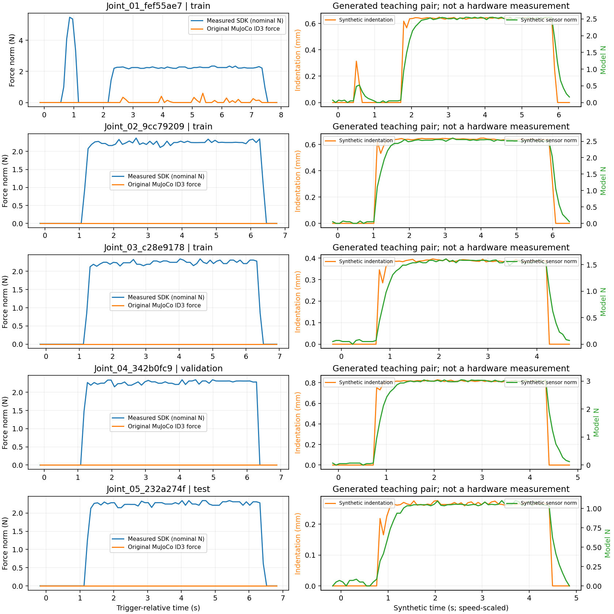
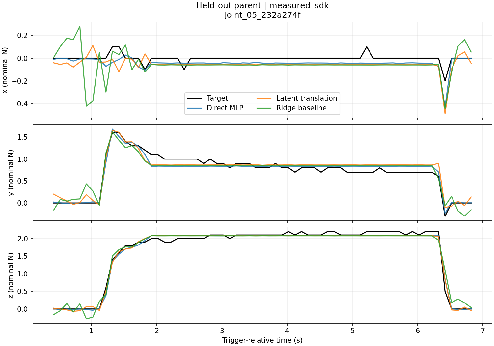

# Lab 4 — Replay, MLPs and cross-modal latent translation

[简体中文](README.zh-CN.md) · [English notebook](practice.en.ipynb) · [中文 Notebook](practice.ipynb)

[English slides: MLPs and latent representations](slides/index.en.html) · [Chinese intro slides](slides/index.html) · [Presentation guide](slides/README.md)

Use recorded robot motion to obtain simulation geometry, predict a three-axis tactile signal with an MLP, and then replace direct prediction with **simulation encoder → latent mapper → sensor decoder**. No new hardware collection is required.

The repository includes **5 measured episodes / 365 original tactile packets** and **300 synthetic sequences / 21,900 paired time steps**. Generated signals are labelled separately from measurements. Compact replay records and deduplicated meshes are included, so replay and dataset regeneration work without a teacher's original data directory.

## 1. What you will learn

By the end of the lab, you should be able to:

- Identify the input, target, split and unit of a supervised-learning sample.
- Train a direct MLP and compare it with mean, zero and ridge-regression baselines.
- Use two autoencoders to compress simulation and sensor windows.
- Freeze pretrained encoders/decoder and train a mapping between their latent spaces.
- Evaluate on a held-out original episode and visualize mapped latents in a common coordinate system.
- Explain why more synthetic rows are not more independent hardware experiments.

A basic understanding of Python arrays and the teacher's introduction to gradient descent is enough. The notebooks expose each training stage; you do not need to edit simulator internals.

## 2. Install from the repository root

Run **every command below from the directory containing `lab1/`, `lab2/` and `lab4/`**. Python 3.12 on Linux CPU was used for the reference run. Use Python 3.10 or newer.

Create a separate Lab 4 environment. Earlier labs pin MuJoCo 3.8.0; Lab 4's mesh-distance replay is verified with **MuJoCo 3.17.0**. In a compatibility check, 3.8 returned a zero distance with separated closest points for this fixture. Do not change the earlier labs' environment to work around this.

Linux/macOS:

```bash
python3 -m venv .venv-lab4
source .venv-lab4/bin/activate
```

Windows PowerShell:

```powershell
py -3 -m venv .venv-lab4
.\.venv-lab4\Scripts\Activate.ps1
```

For CPU-only PyTorch on supported Linux/Windows systems:

```bash
python -m pip install torch --index-url https://download.pytorch.org/whl/cpu
python -m pip install -r lab4/requirements.txt
```

On macOS, install PyTorch from its regular package index instead:

```bash
python -m pip install torch
python -m pip install -r lab4/requirements.txt
```

Check the environment and bundled inputs:

```bash
python -c "import torch, mujoco; print('torch', torch.__version__, 'mujoco', mujoco.__version__)"
python -m lab4.verify
```

The root `requirements.txt` includes Lab 4's **ML-only** dependencies while preserving the old labs' MuJoCo pin. That environment can train on the prepared NPZ features; use the separate environment above for full replay/regeneration. Windows and macOS command forms are provided, but were not independently run in this validation.

## 3. Quick start: observe, train, inspect

First view the bundled [replay comparison](figures/replay_comparison.gif). To render it yourself on headless Linux:

```bash
MUJOCO_GL=egl python -m lab4.replay --data lab4/datasets --out lab4/outputs/replay.gif
```

On a machine with a working default MuJoCo renderer, omit `MUJOCO_GL=egl`. In PowerShell set `$env:MUJOCO_GL="egl"` separately only if EGL is supported on your machine. The output is an animated GIF plus a PNG snapshot. The command does not connect to hardware.

Then train on the measured data and on the expanded synthetic data:

```bash
python -m lab4.train --data lab4/datasets/measured.npz --out lab4/outputs/measured_run1
python -m lab4.train --data lab4/datasets/synthetic.npz --out lab4/outputs/synthetic_run1
```

Open each output directory's `test_predictions.png`, `learning_curves.png`, `latent_space.png` and `metrics.json`. CPU is sufficient. The synthetic run takes longer because it has 60 variants per original episode. Output directories must be new: use `run2` for another experiment instead of overwriting results.

For guided practice:

```bash
python -m pip install jupyterlab ipykernel
python -m ipykernel install --user --name tactile-lab4 --display-name "Tactile Lab 4"
jupyter lab lab4/practice.en.ipynb
```

Select the **Tactile Lab 4** kernel. The Chinese notebook is `lab4/practice.ipynb`. Both contain the same code and experiment settings.

## 4. Understand the replay and the two datasets

| Dataset | Contents | Purpose |
| --- | --- | --- |
| `datasets/measured.npz` | 365 measured ID3 SDK vectors paired with original replay geometry | Small-data learning on similar recorded motions |
| `datasets/synthetic.npz` | 300 generated sequences, 21,900 time steps | Controlled practice with geometry, speed, nonlinear response and lag |
| `datasets/*_sim_inputs.npz` | Simulation features, times, sequence IDs and feature names only | Demonstrate inference without sensor targets |
| `replay_assets/episodes/` | Five compact records with saved simulated joint states, measured vectors and source indices | Reproduce the geometric replay |
| `replay_assets/models/`, `meshes/` | Per-episode MJCF and one copy of each unique mesh | Portable replay without duplicated asset trees |

Measured targets are unchanged apart from float32 conversion for ML. Units are SDK **nominal N**, not an independent force-calibration claim. No original measured timestamps are stretched or replaced.

The original MuJoCo ID3 force is zero in several episodes. The nearest surface point and signed gap still provide geometric input to learning; a nearest point is not necessarily an actual contact point. The task is geometry/motion-to-sensor prediction, not proof that MuJoCo contact force equals measured force.

Synthetic sequences replay the saved joint poses kinematically. Each variant has one fixed virtual fixture translation and a synthetic speed factor:

| Variation | Range |
| --- | --- |
| Requested indentation at the closest reference pose | 0.05–0.85 mm |
| Translation along each of two tangent axes | −0.4 to +0.4 mm |
| Replay speed factor | 0.65×–1.5× |
| Sensor model | Fixed nonlinear stiffness, cross-axis mixing, 160 ms lag, noise and quantization |

Actual signed distances are recomputed with MuJoCo; the requested depth is not guaranteed exactly after a tangent shift. The sensor model constants are teaching choices, not parameters identified from test forces. The generator never uses measured force to position the fixture or synthesize labels. There is no extra hardware measurement or new dynamic rollout.

`time` is speed-scaled for synthetic variants; `source_time` always preserves the original time. `packet_dt_sec` exposes the changed interval to the network. The comparison animation pairs corresponding **poses**, using original playback timing; the two displayed clocks can differ. Its left force is measured SDK output and its right force is explicitly synthetic.



## 5. A training sample and its fields

Each raw row has 11 simulation features and one three-axis target. A causal window contains the current row and six past rows. No window crosses an episode or a packet interval larger than 0.25 s.

| Feature positions | Meaning | Unit |
| --- | --- | --- |
| 0–2 | Closest finger-surface point in the sensor-local frame | mm |
| 3–5 | Local closest-surface normal | unit vector |
| 6 | Signed finger–fixture gap | mm |
| 7 | Backward difference of gap | mm/s |
| 8 | `max(-gap, 0)` geometric indentation | mm |
| 9 | `gap <= 0` geometric contact indicator | 0/1 |
| 10 | Time since the previous packet; zero at sequence start | s |

| NPZ field | Shape | Meaning |
| --- | --- | --- |
| `x`, `y` | `[N,11]`, `[N,3]` | Simulation features and sensor target |
| `time`, `source_time` | `[N]` | Current sequence time and unmodified source time |
| `sequence`, `parent` | `[N]` strings | Variant ID and original episode ID |
| `split` | `[N]` strings | `train`, `validation` or `test` |
| `source_kind` | `[N]` strings | `measured_sdk` or `synthetic_sensor` |
| `raw_event_index`, `sim_frame_index` | `[N]` integers | Trace back to the original recordings |
| `feature_names` | `[11]` strings | Explicit input order |

Inspect with `np.load(..., allow_pickle=False)`. Missing/out-of-range input observations are filtered rather than treated as zero. The first six rows do not produce a seven-row training window. Only training frames determine standardization means/scales.

## 6. Three practical experiments

### A. Direct MLP

A seven-row simulation window becomes a 77-dimensional vector. A Tanh MLP predicts the current target: **77 → 48 → 48 → 3**. Training uses standardized MSE, Adam, gradient clipping and validation-checkpoint selection. The final physical-unit report reverses target standardization.

Compare against zero, training-mean and ridge-regression baselines. A complicated network should earn its complexity by outperforming appropriate simpler baselines.

### B. Two autoencoders

```text
Simulation window: 77 → E_sim → z_sim (8) → D_sim → 77
Sensor window:     21 → E_sensor → z_sensor (4) → D_sensor → 21
```

An encoder compresses observations; a decoder reconstructs them. Latent coordinates do not automatically represent physical quantities. Two independently trained encoders do not automatically share a coordinate system. Using 21-dimensional signal histories makes a four-dimensional sensor bottleneck a meaningful compression exercise.

### C. Latent translation

Freeze both encoders and the sensor decoder, and train **8 → 32 → 32 → 4** between them:

```text
Simulation window → E_sim → z_sim → T → predicted z_sensor → D_sensor → sensor window
```

During training, the sensor encoder supplies the target latent. The objective combines decoded-window MSE with 0.1 times a latent MSE normalized by training latent standard deviations. At inference, only simulation inputs are needed; take the last three decoded values as the current output.

After the measured quick-start training, verify this with a label-free file:

```bash
python -m lab4.predict --model lab4/outputs/measured_run1/models.pt --features lab4/datasets/measured_sim_inputs.npz --out lab4/outputs/prediction_without_labels.npz
```

The script never reads `y`. The sensor autoencoder's **self-reconstruction** metric, by contrast, does read the target at inference and must not be reported as cross-modal prediction.

## 7. Evaluation and reference results

Original episodes 1–3 train, episode 4 validates and episode 5 tests. Every generated descendant inherits its parent's split. Measured window counts are **205 / 65 / 65**; synthetic counts are **12,300 / 3,900 / 3,900**. There are still only **3 / 1 / 1 independent source motions**.

Reference run: seed 7, at most 600 epochs, seven-row windows, latent dimensions 8 and 4. All settings were fixed before looking at test scores.

| Predictor | Measured test RMSE, nominal N | Synthetic test RMSE, model N |
| --- | ---: | ---: |
| Training mean | 0.5409 | 0.6225 |
| Ridge regression | 0.1330 | 0.0479 |
| Direct MLP | 0.0865 | 0.0246 |
| Latent translation | 0.0993 | 0.0704 |

These are similar-motion, single-held-out-parent results. They do not establish generalization across objects, hand poses or collection sessions. Increasing synthetic variants improves experimental coverage, not the number of independent measured episodes. A larger synthetic dataset need not have lower RMSE because its variation range is also broader.



Detailed configuration, environment and interpretation: [reference results](REFERENCE_RESULTS.md). The checked-in figures are curated teaching references; newly generated runs and model checkpoints live under ignored `lab4/outputs/`.

## 8. Change parameters and regenerate more examples

Change `WINDOW`, `SIM_LATENT`, `SENSOR_LATENT`, `EPOCHS` and `DOMAIN` in the notebook's first code cell. For command-line experiments:

```bash
python -m lab4.train --data lab4/datasets/measured.npz --out lab4/outputs/window1 --window 1
python -m lab4.train --data lab4/datasets/synthetic.npz --out lab4/outputs/latent2 --sensor-latent 2
python -m lab4.prepare --out lab4/outputs/regenerated --variants 60 --seed 42
```

`--variants` means variants **per parent**, so 60 gives 300 sequences. To make 500, use `--variants 100` and a new output directory. More variants remain synthetic. Generation includes simulation-only inference files and checksums. To render regenerated data, pass its directory to `--data`; `--parent-index 0..4` selects a source and `--variant` selects a generated variant.

Keep the teacher's parent split. Do not randomly split adjacent frames or descendants of the same original episode across train/test. Select changes using validation data; use the final test set for a final report, rather than repeatedly tuning against it.

## 9. Output files and troubleshooting

| Output | Read it for |
| --- | --- |
| `metrics.json` | Per-axis/aggregate error, split identities, seed, hashes, selected epochs and history |
| `test_predictions.png` | First held-out sequence; numeric scores use all held-out windows |
| `latent_space.png` | Target and mapped latents using one PCA projection fitted on training target latents |
| `learning_curves.png` | Train/validation curves and selected checkpoints |
| `predictions.npz` | Predictions, targets, timestamps and latents for custom plots |
| `models.pt` | Weights, architecture configuration and training-only normalization |

| Problem | Action |
| --- | --- |
| `No module named lab4` | Return to the repository root; run `python -m lab4...` |
| Missing torch / wrong notebook kernel | Activate `.venv-lab4`; select its notebook kernel |
| Replay says MuJoCo is too old | Install `lab4/requirements.txt` in the separate Lab 4 environment |
| EGL/OpenGL error | Use the bundled GIF, or configure a supported local MuJoCo backend; ML training needs no display |
| Output already exists | Choose a new output directory/file |
| Hash mismatch | Restore the distributed files; do not edit the checksum to hide the mismatch |
| Synthetic score differs from a 60-sequence demo | This version adds tangent shifts, speed changes and an interval feature; compare like-for-like configurations |
| Training loss falls while validation rises | The best validation checkpoint is restored; discuss overfitting |

## 10. Suggested 90-minute lab and deliverables

| Time | Task |
| --- | --- |
| 0–10 min | Observe replay; identify measured/generated data and a paired sample |
| 10–30 min | Train direct MLP; compare mean and linear baselines |
| 30–50 min | Train two autoencoders; change bottleneck size |
| 50–70 min | Freeze endpoints; learn latent translation |
| 70–90 min | Compare history lengths/models; explain errors and prepare figures |

Submit a three-axis prediction figure, a latent-space figure, a parameter/error table and answers to two questions: Why can history help with lag? Why can a direct MLP beat a latent mapper? Why is sensor self-reconstruction not prediction? Why do 300 variants still have only five parent recordings?

Implementation entry points are `prepare.py`, `models.py`, `data.py`, `train.py`, `predict.py`, `replay.py`, and `verify.py`. Teacher-only source compaction is in `import_source.py`. Model/data attribution is in [THIRD_PARTY.md](THIRD_PARTY.md).

Validation commands:

```bash
python -m lab4.verify
python -m unittest lab4.test_pipeline -v
```
