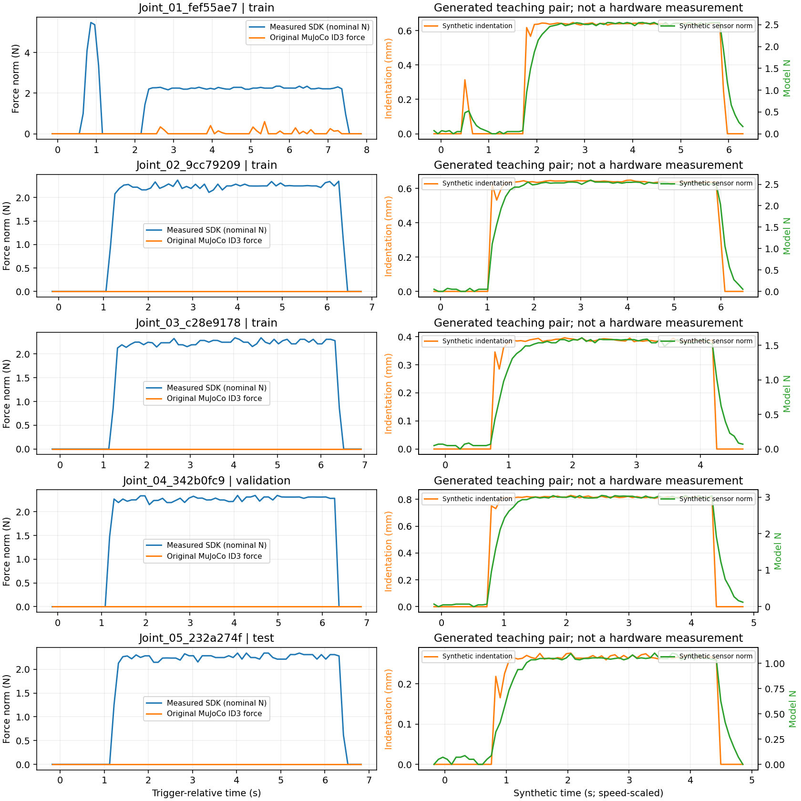
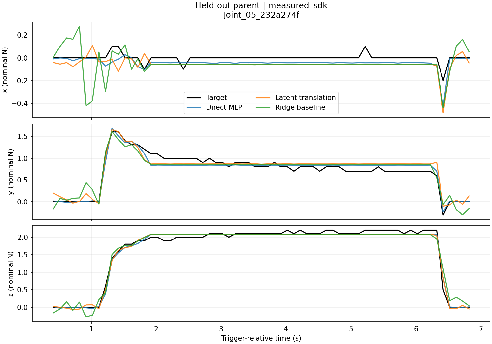

# Lab 4：回放、MLP 与跨模态 latent 转换

[English](README.md) · [中文 Notebook](practice.ipynb) · [English notebook](practice.en.ipynb)

[中文导入幻灯片](slides/index.html) · [英文扩展版：MLP 与 latent](slides/index.en.html) · [中文讲稿](slides/SPEAKER_NOTES.zh-CN.md) · [英文讲稿](slides/SPEAKER_NOTES.en.md)

本实验使用已录制的机器人运动获得仿真几何，先用 MLP 预测三轴触觉信号，再将直接预测拆成 **仿真 encoder → latent 映射 → 传感器 decoder**。学生不需要新增真机采集。

仓库已包含 **5 条实测记录、365 个原始触觉包**，以及 **300 条合成序列、21,900 个配对时刻**。实测与生成信号分别标记。回放记录和去重后的网格也已随仓库提供，重新回放、生成数据不依赖教师电脑上的原始目录。

## 1. 实验目标

完成后应能：

- 说明监督学习中输入、目标、数据划分和单位分别是什么。
- 训练直接 MLP，并和均值、全零、ridge 线性回归基线比较。
- 用两个自编码器压缩仿真窗口和传感器窗口。
- 冻结已经训练好的编码器/解码器，学习两个 latent 空间之间的映射。
- 在留出的原始记录上评价，并在同一坐标系中观察映射结果。
- 解释为什么更多合成数据行不等于更多独立真机实验。

具备基础 Python 数组知识，并听过老师关于梯度下降的介绍即可。Notebook 按阶段展开训练，第一轮不需要编辑仿真内部实现。

## 2. 从仓库根目录安装

**以下所有命令都在同时包含 `lab1/`、`lab2/`、`lab4/` 的仓库根目录运行。** 参考结果使用 Linux、Python 3.12、CPU；建议 Python 3.10 或以上。

为 Lab 4 单独建立环境。前面课程固定 MuJoCo 3.8.0，Lab 4 网格距离回放使用已验证的 **MuJoCo 3.17.0**。兼容性检查发现，3.8 在本工装的部分查询中会出现“最近点分离但距离返回零”；不要为此修改旧课程环境。

Linux/macOS：

```bash
python3 -m venv .venv-lab4
source .venv-lab4/bin/activate
```

Windows PowerShell：

```powershell
py -3 -m venv .venv-lab4
.\.venv-lab4\Scripts\Activate.ps1
```

支持 CPU PyTorch wheel 的 Linux/Windows：

```bash
python -m pip install torch --index-url https://download.pytorch.org/whl/cpu
python -m pip install -r lab4/requirements.txt
```

macOS 使用常规包索引安装 PyTorch：

```bash
python -m pip install torch
python -m pip install -r lab4/requirements.txt
```

检查环境和随仓库提供的输入：

```bash
python -c "import torch, mujoco; print('torch', torch.__version__, 'mujoco', mujoco.__version__)"
python -m lab4.verify
```

根目录 `requirements.txt` 包含 Lab 4 的 **ML 依赖**，同时保留旧课程 MuJoCo 版本。该环境可以使用已经准备的 NPZ 特征训练；完整回放与重新生成几何使用上面的独立环境。Windows/macOS 命令形式已给出，但本次没有分别在这些平台实测。

## 3. 快速开始：看回放、训练、看结果

先打开仓库附带的 [回放对照动画](figures/replay_comparison.gif)。在无图形桌面的 Linux 上自行生成：

```bash
MUJOCO_GL=egl python -m lab4.replay --data lab4/datasets --out lab4/outputs/replay.gif
```

本机默认 MuJoCo 渲染器可用时，可以省略 `MUJOCO_GL=egl`。PowerShell 中如需且支持 EGL，应先单独设置 `$env:MUJOCO_GL="egl"`。输出是 GIF 动画和一张 PNG；该命令不连接真机。

分别在实测和扩充后的合成数据上训练：

```bash
python -m lab4.train --data lab4/datasets/measured.npz --out lab4/outputs/measured_run1
python -m lab4.train --data lab4/datasets/synthetic.npz --out lab4/outputs/synthetic_run1
```

打开输出目录中的 `test_predictions.png`、`learning_curves.png`、`latent_space.png` 和 `metrics.json`。CPU 即可运行。合成实验每条原始记录有 60 个变体，因此耗时更长。输出目录必须是新目录；再次实验请改成 `run2`，不覆盖已有结果。

需要逐步操作时：

```bash
python -m pip install jupyterlab ipykernel
python -m ipykernel install --user --name tactile-lab4 --display-name "Tactile Lab 4"
jupyter lab lab4/practice.ipynb
```

选择 **Tactile Lab 4** kernel。英文 Notebook 为 `lab4/practice.en.ipynb`。两份 Notebook 使用相同代码与实验参数。

## 4. 理解回放与两份数据

|数据|内容|用途|
|---|---|---|
|`datasets/measured.npz`|365 个真实 ID3 SDK 三轴向量与原始回放几何|相似运动下的小样本学习|
|`datasets/synthetic.npz`|300 条生成序列、21,900 个时刻|几何、速度、非线性响应和滞后的可控练习|
|`datasets/*_sim_inputs.npz`|只有仿真特征、时间、序列编号和特征名|验证推理时不需要传感器标签|
|`replay_assets/episodes/`|五份紧凑记录，含保存的仿真关节状态、实测向量和源索引|重新得到回放几何|
|`replay_assets/models/`、`meshes/`|每条记录的 MJCF；每个不同网格只保留一份|可迁移回放，避免重复五套网格|

实测目标除训练文件中的 float32 转换外没有改变。单位为 SDK **名义 N** 换算，不代表独立力标定。原始实测时间戳没有被拉伸或替换。

部分记录的原始 MuJoCo ID3 力为零。最近表面点与有符号间隙仍可提供几何输入，但最近点不一定是实际接触点。本课学习的是几何/运动到传感器响应的关系，不以此证明仿真接触力等于真机力。

合成序列按保存的关节姿态做运动学回放。每个变体只有一个固定虚拟工装平移和一个合成速度系数：

|变化项|范围|
|---|---|
|在最近参考姿态请求的压入量|0.05–0.85 mm|
|两个切向轴各自的平移|−0.4 至 +0.4 mm|
|回放速度系数|0.65×–1.5×|
|传感器模型|固定非线性刚度、轴间耦合、160 ms 滞后、噪声与量化|

实际距离重新通过 MuJoCo 计算；加入切向平移后，实际压入量不一定等于请求值。传感器参数是教学设定，没有用测试力曲线拟合。生成器不会用真实力调整工装位置或生成标签。这些序列不是新增真机测量，也不是新的动力学 rollout。

合成 `time` 按速度缩放，`source_time` 始终保留原始时间；网络可以通过 `packet_dt_sec` 获得改变后的采样间隔。左右回放动画按**相同姿态索引**对照，采用原始播放节奏，所以两边显示的时间可能不同。左侧曲线值是实测 SDK 输出，右侧明确为合成输出。



## 5. 一对训练样本及其字段

每行有 11 维仿真特征与三轴目标。因果窗口由当前行和过去六行构成；窗口不会跨越 episode，也不会跨越超过 0.25 秒的包间隔。

|特征位置|含义|单位|
|---|---|---|
|0–2|传感器局部坐标中的手指表面最近点|mm|
|3–5|局部最近表面法向|单位向量|
|6|手指—工装有符号间隙|mm|
|7|间隙的后向差分速度|mm/s|
|8|`max(-gap, 0)` 几何压入量|mm|
|9|`gap <= 0` 几何接触指示|0/1|
|10|与上一个包的时间间隔；序列起始为零|s|

|NPZ 字段|形状|含义|
|---|---|---|
|`x`、`y`|`[N,11]`、`[N,3]`|仿真特征与传感器目标|
|`time`、`source_time`|`[N]`|当前序列时间与未改变的来源时间|
|`sequence`、`parent`|`[N]` 字符串|变体编号与原始 episode 编号|
|`split`|`[N]` 字符串|`train`、`validation`、`test`|
|`source_kind`|`[N]` 字符串|`measured_sdk` 或 `synthetic_sensor`|
|`raw_event_index`、`sim_frame_index`|`[N]` 整数|回溯原始记录的索引|
|`feature_names`|`[11]` 字符串|明确的输入顺序|

使用 `np.load(..., allow_pickle=False)` 读取。缺失或仿真范围外的数据过滤处理，不当成零；前六行不足以构成七帧窗口，不参与该模型的评价。标准化均值与尺度只在训练帧上估计。

## 6. 三个实践实验

### A. 直接 MLP

七帧仿真窗口展开为 77 维，用 Tanh MLP 预测当前三轴输出：**77 → 48 → 48 → 3**。训练使用标准化 MSE、Adam、梯度裁剪，并根据验证集选 checkpoint。最终指标会反标准化到目标的名义单位。

同时比较全零、训练均值和 ridge 线性回归。先看简单模型能做到什么，再讨论复杂结构的收益。

### B. 两个自编码器

```text
仿真窗口：77 → E_sim → z_sim（8 维）→ D_sim → 77
信号窗口：21 → E_sensor → z_sensor（4 维）→ D_sensor → 21
```

Encoder 压缩观测，decoder 根据压缩表示重建观测。Latent 坐标不会自动变成具有物理意义的变量；分别训练的两个 encoder 也不会自动采用同一坐标系。使用 21 维信号历史，使 4 维传感器瓶颈具有明确的压缩意义。

### C. Latent 转换

冻结两个 encoder 和传感器 decoder，在中间训练 **8 → 32 → 32 → 4**：

```text
仿真窗口 → E_sim → z_sim → T → 预测 z_sensor → D_sensor → 传感器窗口
```

训练时，传感器 encoder 提供目标 latent。损失由解码窗口 MSE，加上 0.1 倍按训练 latent 标准差归一化的 latent MSE 组成。推理时只需要仿真输入；解码结果最后三个数作为当前三轴输出。

完成实测快速训练后，用没有真实标签的文件验证：

```bash
python -m lab4.predict --model lab4/outputs/measured_run1/models.pt --features lab4/datasets/measured_sim_inputs.npz --out lab4/outputs/prediction_without_labels.npz
```

该脚本不读取 `y`。与此不同，传感器自编码器的 **self-reconstruction** 指标在推理时读取了目标信号，只是压缩效果参考，不能算作跨模态预测。

## 7. 评价与参考结果

原始第 1–3 条用于训练，第 4 条验证，第 5 条测试；每个合成变体继承父记录的划分。实测窗口数为 **205 / 65 / 65**；合成窗口数为 **12,300 / 3,900 / 3,900**。独立原始运动来源仍只有 **3 / 1 / 1** 条。

参考实验使用 seed 7、最多 600 epochs、七帧窗口、8/4 维 latent；参数在查看测试成绩之前确定。

|预测模型|实测测试 RMSE，名义 N|合成测试 RMSE，模型 N|
|---|---:|---:|
|训练均值|0.5409|0.6225|
|Ridge 线性回归|0.1330|0.0479|
|直接 MLP|0.0865|0.0246|
|Latent 转换|0.0993|0.0704|

这些是相似动作、单个留出父记录上的结果，不代表跨物体、手型或采集 session 的泛化。增加变体扩充了教学工况，但没有增加独立实测记录数。更大合成集也不保证更低 RMSE，因为其变化范围同时扩大了。



完整配置、环境和结果解读见 [参考结果](REFERENCE_RESULTS.md)。仓库只保留选定的教学参考图；新实验与模型 checkpoint 都写入已忽略的 `lab4/outputs/`。

## 8. 改参数、生成更多数据

修改 Notebook 第一个代码单元的 `WINDOW`、`SIM_LATENT`、`SENSOR_LATENT`、`EPOCHS`、`DOMAIN`。也可使用命令行：

```bash
python -m lab4.train --data lab4/datasets/measured.npz --out lab4/outputs/window1 --window 1
python -m lab4.train --data lab4/datasets/synthetic.npz --out lab4/outputs/latent2 --sensor-latent 2
python -m lab4.prepare --out lab4/outputs/regenerated --variants 60 --seed 42
```

`--variants` 表示**每条父记录**的变体数，60 会得到 300 条；改成 `--variants 100` 并选择新目录可生成 500 条。更多变体仍是合成数据。生成过程同时导出无标签仿真输入和校验和。渲染新数据时，把新目录传给 `--data`；用 `--parent-index 0..4` 选择原始记录，用 `--variant` 选择变体。

保留教师提供的父记录划分，不能将相邻帧或同一原始记录派生的数据随机拆到训练集与测试集。改参数主要看验证集，最后报告测试结果；反复根据测试成绩调参后，它就不再是独立测试。

## 9. 输出文件与常见问题

|输出|用途|
|---|---|
|`metrics.json`|每轴/总体误差、划分身份、随机种子、哈希、选定 epoch 和训练历史|
|`test_predictions.png`|第一条测试序列的曲线；数值指标使用全部测试窗口|
|`latent_space.png`|目标与映射 latent，使用只在训练目标 latent 上拟合的一套 PCA 投影|
|`learning_curves.png`|训练/验证曲线及选中的 checkpoint|
|`predictions.npz`|逐窗口预测、目标、时间和 latent，可自行绘图|
|`models.pt`|权重、结构配置和仅由训练集得到的标准化参数|

|问题|处理|
|---|---|
|`No module named lab4`|回到仓库根目录，用 `python -m lab4...`|
|找不到 torch / Notebook kernel 不对|激活 `.venv-lab4`，选择对应 kernel|
|提示 MuJoCo 版本过旧|在独立 Lab 4 环境安装 `lab4/requirements.txt`|
|EGL/OpenGL 错误|先看随仓库提供的 GIF，或配置本机支持的 MuJoCo 后端；ML 训练不需要显示器|
|输出已存在|换一个输出目录或文件名|
|哈希不一致|恢复分发文件，不要通过改校验和隐藏问题|
|成绩和早期 60 条示例不同|本版增加切向变化、速度变化和间隔特征，应比较相同配置|
|训练损失降、验证损失升|最终会恢复最佳验证 checkpoint；可作为过拟合讨论|

## 10. 90 分钟安排与提交

|时间|任务|
|---|---|
|0–10 分钟|看回放，辨认实测/合成来源与一对样本|
|10–30 分钟|直接 MLP，比较均值和线性基线|
|30–50 分钟|训练两个自编码器，改变瓶颈维数|
|50–70 分钟|冻结两端，训练 latent 映射|
|70–90 分钟|比较历史长度/模型，解释误差并准备图表|

提交一张三轴预测图、一张 latent 图、一张参数/误差表，并回答两个问题：历史为什么可能帮助滞后预测？MLP 为什么可能胜过 latent 映射？自重建为什么不是跨模态预测？300 个变体为什么仍只有五条原始记录？

实现入口是 `prepare.py`、`models.py`、`data.py`、`train.py`、`predict.py`、`replay.py`、`verify.py`；教师原始数据整理工具为 `import_source.py`。模型与数据来源见 [THIRD_PARTY.md](THIRD_PARTY.md)。

验证命令：

```bash
python -m lab4.verify
python -m unittest lab4.test_pipeline -v
```
